# The Club — Engineering Architecture

How The Club is built, for engineers joining the project and for reviewers. It describes the code as it is on `main`:
which pieces exist, how they talk to each other, where data lives, how requests are secured, how it is deployed and
what is known to be weak.

Related documents:

| Document | Use it for |
|---|---|
| [ARCHITECTURE_OVERVIEW.md](ARCHITECTURE_OVERVIEW.md) | Plain-language description and the feature tables (who can do what). Not repeated here. |
| [SERVICE_CONTRACTS.md](SERVICE_CONTRACTS.md) | Every gateway route, internal endpoint, email template, payment and Strava contract. The source of truth for APIs. |
| [DATABASE_MIGRATIONS.md](DATABASE_MIGRATIONS.md) | Flyway conventions and how to change a schema |
| [PRODUCTION.md](PRODUCTION.md) | Single-host Docker Compose deployment, secrets, TLS, backups, key rotation, CI/CD |
| [KUBERNETES.md](KUBERNETES.md) | The Helm chart, its values and how it maps from Compose |
| [CLOUD_DEPLOYMENT.md](CLOUD_DEPLOYMENT.md) | AWS, Google Cloud and Azure on top of the chart |
| [OBSERVABILITY.md](OBSERVABILITY.md) | Metrics, traces, logs, dashboards, alerts |
| [NATIVE_APPS.md](NATIVE_APPS.md), [EMAIL_SETUP.md](EMAIL_SETUP.md), [STRAVA_SETUP.md](STRAVA_SETUP.md), [RUN_AND_TEST.md](RUN_AND_TEST.md) | The apps, email providers, Strava, local running and testing |

The `*.txt` / `*.md.txt` files in the repository root are early design notes and may not match the code.

---

## 1. Tech stack

Versions come from `pom.xml`, the module poms, `web-app/package.json`, the Dockerfiles and the compose files.

| Layer | Technology | Version / source |
|---|---|---|
| Language (backend) | Java | 21 (`java.version`, `eclipse-temurin:21-jre-jammy` runtime image) |
| Framework | Spring Boot | 4.0.8 (`spring-boot-starter-parent`) |
| | Spring Cloud | 2025.1.3: Gateway Server WebFlux, Netflix Eureka, OpenFeign, Config Server |
| | Spring Security | via Boot; stateless, configured in `common-lib` |
| JSON | Jackson 3 (`tools.jackson.databind`) | managed by Boot; `spring.jackson.use-jackson2-defaults: true` everywhere |
| JWT | jjwt | 0.13.0 |
| IDs | `java-uuid-generator` (UUIDv7) | 5.2.0 |
| Scheduled-job locking | ShedLock (`shedlock-spring`, JDBC provider) | 7.10.1 (event-service only) |
| QR codes | ZXing | 3.5.4 (event-service) |
| Object storage SDKs | AWS SDK v2 BOM 2.57.1, Google Cloud libraries BOM 26.89.0, Azure SDK BOM 1.3.8 | user-, club-, event-service and `common-lib` (optional) |
| Email templating | Thymeleaf | notification-service (`EmailRenderer`) |
| Migrations | Flyway (`spring-boot-starter-flyway`) | managed by Boot |
| Databases | MySQL 8 (`mysql:8.0` image), PostgreSQL 15 (`postgres:15`) | tests: H2 and Testcontainers (`mysql:8.4`, `postgres:15`) |
| Cache / pub-sub (optional) | Redis | `redis:7.4-alpine` in the Helm chart; not in Compose |
| Object storage (Compose) | SeaweedFS S3 | `chrislusf/seaweedfs:4.47` |
| Frontend | React 19, React Router 7, TypeScript ~7.0, Vite 8, Vitest 5, oxlint | `web-app/package.json` |
| Native shells | Capacitor 8 (Android, iOS), Tauri 2 (macOS) | `web-app/android`, `web-app/ios`, `web-app/src-tauri` |
| Web server | nginx | `nginxinc/nginx-unprivileged:1.30-alpine`, build stage `node:22-alpine` |
| Observability | Micrometer + OpenTelemetry bridge, Prometheus v2.55.1, Alertmanager v0.27.0, OTel Collector contrib 0.111.0, Tempo 2.6.1, Loki 3.2.1, Alloy v1.4.3, Grafana 11.3.0 | `docker-compose.observability.yml` |
| Dev extras | Mailpit v1.20, Trino 460 | `docker-compose.override.yml` |
| Backups off-site | rclone 1.70.3 | Compose profile `offsite`, Helm `backups.offsite` |
| Kubernetes | Helm chart `the-club` 0.3.0, `kubeVersion >=1.27` | `deploy/helm/the-club/Chart.yaml` |

---

## 2. System context and containers

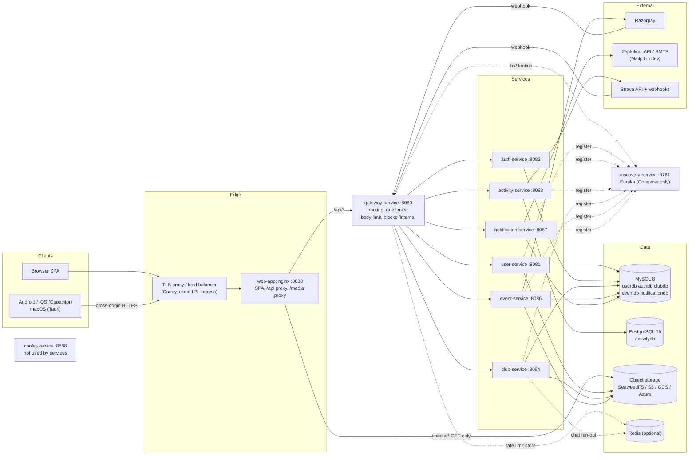

**Request path.** Every public request enters through nginx in the `web-app` container, which serves the SPA, proxies
`/api/` to the gateway and `/media/` (read-only) to the bucket. The gateway routes `/api/v1/**` by path prefix to the
six domain services. Browsers use the same origin as the SPA, so CORS and the HttpOnly refresh cookie need nothing
special. The native apps call the gateway cross-origin; the gateway's CORS allow-list includes `capacitor://localhost`
and `tauri://localhost` by default (`gateway-service/src/main/resources/application.yml`).

**Service discovery.** In Docker Compose every service registers with Eureka (`discovery-service`) and the gateway
routes to `lb://<service>`. Feign clients resolve by name unless `theclub.clients.<service>.url` is set. In Kubernetes
the chart sets `EUREKA_CLIENT_ENABLED=false` and fills `<SERVICE>_SERVICE_URL` (Feign) and `<SERVICE>_SERVICE_URI`
(gateway routes) with ClusterIP Service URLs (`deploy/helm/the-club/templates/configmap.yaml`); discovery- and
config-service are not deployed by default.

**config-service** runs a Spring Cloud Config Server (`native` profile with `classpath:/config-repo`, or a git backend
via `CONFIG_GIT_URI`), but no service imports configuration from it. Each service ships its own `application.yml`.

**External systems.**

| System | Used by | How |
|---|---|---|
| Razorpay | event-service | REST (`RazorpayPaymentGateway`, `RestClient`, basic auth) for orders, payment lookup and refunds; browser checkout script from `checkout.razorpay.com`; webhook to `/api/v1/payments/webhooks/razorpay` |
| ZeptoMail / SMTP | notification-service | `ZeptoMailEmailProvider` (HTTP API, 5 s connect / 15 s read), `SmtpEmailProvider`, `LogEmailProvider`; bounce webhook `/api/v1/notifications/webhooks/zeptomail` |
| Strava | activity-service | OAuth, REST (`StravaClient` with its own timeouts and rate-limit tracking), push webhook `/api/v1/strava/webhook` |
| OpenStreetMap | web app only | Outbound "open map" links (`web-app/src/lib/location.ts`); no map API is called |

---

## 3. Service catalogue

Ports are the services' own `server.port`. Tables come from `CREATE TABLE` statements in each service's Flyway
migrations. Route prefixes are the gateway predicates. Internal endpoints are listed in full in
[SERVICE_CONTRACTS.md](SERVICE_CONTRACTS.md#internal-endpoints).

| Service | Port | Database | Owns tables | Public route prefixes | Internal endpoints exposed | Calls (Feign) | Background work |
|---|---|---|---|---|---|---|---|
| gateway-service | 8080 | none (Redis optional) | — | all of `/api/v1/**` | — | routes to all six | — |
| user-service | 8081 | MySQL `userdb` | `users`, `user_roles`, `user_tokens` | `/api/v1/users/**` | `/internal/users/by-email/{email}`, `/{id}`, `/summaries`, `/{id}/roles` (POST, DELETE) | auth (`/internal/auth/sessions`), notification | `AdminBootstrap` on startup |
| auth-service | 8082 | MySQL `authdb` | `auth_tokens`, `login_attempts` | `/api/v1/auth/**` | `/internal/auth/sessions/{userId}` (DELETE) | user (`/internal/users`) | — |
| activity-service | 8083 | PostgreSQL `activitydb` | `activities`, `strava_connections`, `strava_webhook_events` | `/api/v1/activities/**`, `/api/v1/strava/**` | `/internal/activities/stats`, `/internal/activities/{id}` | notification; Strava (REST, not Feign) | `StravaWebhookWorker` every 10 s on every replica (row lease) |
| club-service | 8084 | MySQL `clubdb` | `clubs`, `club_memberships`, `club_follows`, `club_photos`, `club_reviews`, `club_posts`, `club_post_photos`, `post_likes`, `post_comments`, `owner_verification_requests`, `owner_verification_documents`, `owner_verification_audit`, `chat_conversations`, `chat_messages`, `chat_reads`, `chat_blocks`, `chat_reports`, `club_chat_mutes` | `/api/v1/clubs/**`, `/api/v1/owner-verification/**`, `/api/v1/chat/**` | `/internal/clubs/{clubId}`, `/{clubId}/members/{userId}`, `/summaries`, `/{clubId}/audience`, `/users/{userId}/related`, `/nearby`, `/in-city` | user, activity, event, notification | `ChatRelay` every 2 s and `ChatHub` heartbeat, on every replica |
| event-service | 8086 | MySQL `eventdb` | `events`, `event_registrations`, `payments`, `payment_webhook_events`, `points_ledger`, `shedlock` | `/api/v1/events/**`, `/api/v1/payments/**`, `/api/v1/participation/**`, `/api/v1/leaderboards/**` | `/internal/events/{eventId}`, `/internal/events/attendance` | club, user, notification; Razorpay (REST) | `PaymentReconciler` every 5 min, one replica at a time (ShedLock) |
| notification-service | 8087 | MySQL `notificationdb` | `notifications`, `email_outbox`, `email_suppression` | `/api/v1/notifications/**` | `/internal/notifications` (POST) | none | `EmailDispatcher` every 5 s on every replica (`SKIP LOCKED`) |
| discovery-service | 8761 | — | — | — | — | — | Eureka server |
| config-service | 8888 | — | — | — | — | — | Config Server (unused) |

Notes:

* **Mutual dependency.** club-service calls event-service (`EventClient`: reshared events, review eligibility through
  `attendance`), and event-service calls club-service (`ClubClient`: ownership, membership, audience, feed). Neither
  needs the other to start, but each degrades when the other is down.
* **Public paths without a JWT** are declared per service in `theclub.security.public-paths`: user registration,
  email verification and password reset (user-service); login, refresh, logout and JWKS (auth-service); Strava
  callback and webhook (activity-service); the post preview `/api/v1/clubs/*/posts/*/preview` (club-service); the
  Razorpay webhook (event-service); the ZeptoMail webhook (notification-service). Webhooks authenticate with their own
  signature or token instead.
* **Package layout** is `com.theclub.<name>service.{controller,service,repository,model,dto,client,config}`, with
  extra packages where a domain needs them (`event-service/.../payment`, `activity-service/.../strava`,
  `notification-service/.../email`). Public and internal controllers are separate classes, for example
  `InternalEventController`, `InternalClubController`.

---

## 4. Cross-cutting: common-lib

`common-lib` is a plain jar every domain service depends on (not the gateway, discovery- or config-service). It is
wired in through `META-INF/spring/org.springframework.boot.autoconfigure.AutoConfiguration.imports`, which lists two
auto-configurations. A change in `common-lib` affects every service.

| Concern | Where | What it does |
|---|---|---|
| Auto-configuration | `config/TheClubCommonAutoConfiguration` | Servlet apps only. Registers the zone-aware `Clock`, `JwtService`, the security filter chain, `RequestIdFilter`, the Feign interceptor, `ProductionSafetyCheck`, `GlobalExceptionHandler`, `RequestIdProblemDetailAdvice`, a context-propagating `TaskDecorator` for `@Async`, and an observation predicate that drops actuator and Eureka noise from traces. `@EnableMethodSecurity` is on. |
| Security chain | same class | Stateless, CSRF/basic/form login off. `DispatcherType.ASYNC` permitted (SSE completion), `/internal/**` requires `ROLE_INTERNAL`, `/actuator/health/**`, `/actuator/info`, `/actuator/prometheus`, `/error` and `OPTIONS` are open, configured public paths are open, everything else needs authentication. 401/403 are problem documents (`ProblemAuthenticationEntryPoint`). |
| JWT verification | `security/JwtAuthenticationFilter`, `JwtService`, `RsaKeys`, `JwtProperties` | Parses `Authorization: Bearer`, verifies RS256 against the current and optional previous public key, checks the issuer using the injected `Clock`, and sets an `AuthenticatedUser` principal with `ROLE_<role>` authorities. Invalid tokens leave the request anonymous. |
| Internal calls | `security/InternalApiKeyFilter` + Feign `RequestInterceptor` | Constant-time compare of `X-Internal-Key`; on match grants `ROLE_INTERNAL`. The interceptor adds the key and the current `X-Request-Id` to every outgoing Feign request. |
| Errors | `web/GlobalExceptionHandler`, `web/ApiException`, `web/FeignExceptionHandler` | RFC 7807 `ProblemDetail` everywhere. `ApiException` carries status, optional machine-readable `code` and field `errors`. Bean-validation failures become 400 with an `errors` map. `DataIntegrityViolationException` → 409, optimistic-lock failures → 409 `CONCURRENT_UPDATE`. Unhandled Feign errors → 502, unreachable dependency (`RetryableException`) → 503. |
| Request IDs | `observability/RequestIdFilter`, `RequestIds`, `RequestIdProblemDetailAdvice` | Accepts a caller's `X-Request-Id` if it matches `[A-Za-z0-9._:-]{1,64}`, otherwise makes one; puts it in the MDC (`requestId`), the response header and every problem body. The gateway's `RequestIdWebFilter` assigns it at the edge. |
| Business metrics | `observability/BusinessMetrics` | `theclub_<domain>_<event>_total` counters with low-cardinality tags. See [OBSERVABILITY.md](OBSERVABILITY.md#metrics). |
| Production guard | `config/ProductionSafetyCheck` | With the `prod` profile, refuses to start if `INTERNAL_API_KEY` is shorter than 32 characters or contains `change-me`, `ADMIN_PASSWORD` contains `change-me`, `AUTH_COOKIE_SECURE` or `REQUIRE_EMAIL_VERIFICATION` is `false`, `ADMIN_EMAIL` is a placeholder mailbox (`*.local`, `example.com`, …), or `APP_BASE_URL` is not a public `https://` address (or is still an `example.com` one). Each setting is checked only in the services that read it. Without `prod`, a public `https://` `APP_BASE_URL` is refused too (a real deployment on the dev profile), unless `ALLOW_DEV_PROFILE_ON_PUBLIC_URL=true`. Other prod refusals live in their services: mock payments (`PaymentGatewayConfig`), missing Razorpay secrets (`RazorpayPaymentGateway`), mail provider checks (notification-service), Strava settings (`StravaConfigurationCheck`). |
| IDs | `util/UuidGenerator` | UUIDv7 (`Generators.timeBasedEpochGenerator()`), stored as `CHAR(36)` with `@JdbcTypeCode(SqlTypes.CHAR)`. Time-ordered, so ordering by ID is ordering by creation time (chat relies on this). |
| Media | `media/MediaAutoConfiguration`, `MediaStore`, `BlobMediaStore`, `S3MediaStore`, `GcsMediaStore`, `AzureMediaStore`, `DisabledMediaStore` | Active only where the S3 SDK is on the classpath (user-, club-, event-service). Without a bucket it is `DisabledMediaStore` (uploads answer 503 `MEDIA_NOT_CONFIGURED`). `BlobMediaStore` checks content by magic bytes (JPEG/PNG/WebP images; PDF too for documents) and `MEDIA_MAX_SIZE`, and writes under `<folder>/<UUIDv7>.<ext>`. Public images return `MEDIA_PUBLIC_BASE_URL/<key>`; `storePrivate` writes under `private/` into `MEDIA_PRIVATE_BUCKET` or the same bucket and only returns the key. The Google and Azure types are isolated in the nested `Gcs` / `Azure` holder classes so the optional SDKs load only when chosen. |

### Time and time zones

* "Now" always comes from the injected `java.time.Clock`, built as `Clock.system(ZoneId.of(theclub.time-zone))`;
  `theclub.time-zone` is `APP_TIME_ZONE`, default `Asia/Kolkata`. Tests replace it (`MutableClock`).
* Domain times are `LocalDateTime` in that zone. Entities' own `@PrePersist` timestamps use the JVM default zone, so
  Compose (`JAVA_TOOL_OPTIONS ... -Duser.timezone=${APP_TIME_ZONE}`) and the Helm chart start every JVM in the same zone
  while the containers themselves run in UTC.
* Strava activities keep the athlete's local start (`startTime`) plus `startTimeUtc` and `timeZone`.
* There is one platform time zone; clubs in other zones see times in it.

### Jackson 3

Spring Boot 4 uses Jackson 3: `ObjectMapper`/`JsonNode` are in `tools.jackson.databind` and `JacksonException` is
unchecked, while annotations remain in `com.fasterxml.jackson.annotation`. Every service sets
`spring.jackson.use-jackson2-defaults: true` so the API behaves as it did under Jackson 2 (for example, missing
primitive fields are not rejected).

### Validation

Request DTOs use Jakarta Bean Validation (`spring-boot-starter-validation`, `@Valid` on controller parameters). Rules
that need data (password policy in `PasswordPolicy`, registration windows in `RegistrationService`, owner checks)
throw `ApiException` with a `code` where clients need to branch.

---

## 5. Security model

### Tokens and sessions

| Item | Implementation |
|---|---|
| Access token | RS256 JWT issued only by auth-service (`JwtService.issueAccessToken`), 15 min (`JWT_EXPIRATION`). Claims: `sub`, `email`, `name`, `roles`, `iss`; header `kid` (`JWT_KEY_ID`, default `k1`). |
| Verification | Every service verifies locally with the public key (`JWT_PUBLIC_KEY`); no call to auth-service per request. Only auth-service mounts `JWT_PRIVATE_KEY`. |
| Key rotation | `JWT_PREVIOUS_PUBLIC_KEY` is accepted alongside the current key; `GET /api/v1/auth/.well-known/jwks.json` publishes both (`<kid>` and `<kid>-previous`). Procedure: [PRODUCTION.md §8](PRODUCTION.md#8-rotating-the-jwt-signing-key). |
| Refresh token | Opaque random value, 14 days (`JWT_REFRESH_EXPIRATION`), stored as a SHA-256 hash in `auth_tokens`, rotated on every `/refresh` (the presented token is deleted even when the refresh fails). Refresh re-reads the user from user-service, so new roles and deactivation take effect at the next refresh. |
| Browser transport | Cookie `theclub_refresh`, HttpOnly, SameSite=Strict, `Path=/api/v1/auth`, Secure unless `AUTH_COOKIE_SECURE=false`. The SPA keeps the access token in memory only (`web-app/src/api/client.ts`). |
| Native transport | The apps never receive the cookie (cross-origin), so they store the refresh token in app storage and send it in the JSON body of `/refresh` and `/logout` (`isNativeApp`, `web-app/src/lib/platform.ts`). Auth changes must work in both modes. |
| Login protection | BCrypt password hashes (user-service holds them; auth-service compares via `/internal/users/by-email`). `LoginThrottle`: 5 failures in 15 min lock the email for 15 min (429). Unverified email → 403 `EMAIL_NOT_VERIFIED` when `REQUIRE_EMAIL_VERIFICATION=true`. |
| Revocation | `POST /api/v1/auth/logout-all`; password reset or change calls `DELETE /internal/auth/sessions/{userId}` after commit. |
| One-time account links | Email verification and password reset tokens are stored hashed in `user_tokens` with a purpose and expiry (`AccountTokens`); links point at `APP_BASE_URL`. |

### Authorization

* **Roles** (`common-lib` `Roles`): `USER` for everyone, `CLUB_OWNER` granted on the first approved club application,
  `ADMIN` for the bootstrap admin (`ADMIN_EMAIL` / `ADMIN_PASSWORD`, created by user-service `AdminBootstrap`).
  `INTERNAL` exists only for `/internal/**` callers.
* **Ownership is per club.** The role alone allows nothing: club-service checks `ClubService.requireOwnerOrAdmin`,
  event-service checks `ClubAccess` (which asks club-service's internal API). `POST /api/v1/clubs` is admin-only, and
  only admins can change a club's verified name.
* Role changes reach the caller's token only after `POST /api/v1/auth/refresh`.

### Service-to-service

`/internal/**` endpoints require `X-Internal-Key` (`INTERNAL_API_KEY`, ≥ 32 chars under `prod`). The gateway never
routes them: no route matches, the discovery locator is off, and `BlockInternalPathsFilter` (highest precedence)
returns 404 for any raw path containing `/internal`, `%2f`, `%2e` or `/..`, and strips any `X-Internal-Key` sent by a
client. All services share one key; anyone holding it can call any internal endpoint.

### Edge hardening (gateway)

Global filters, in order:

| Order | Filter | Behaviour |
|---|---|---|
| `HIGHEST_PRECEDENCE` | `RequestIdWebFilter` (WebFilter), `BlockInternalPathsFilter` | Request ID; 404 for internal or encoded paths |
| +5 | `SecurityHeadersFilter` | `X-Content-Type-Options: nosniff`, `Referrer-Policy: no-referrer`; `Cache-Control: no-store` and `Pragma: no-cache` on `/api/v1/auth/**` |
| +10 | `RateLimitFilter` | Per client IP. Strict bucket (POST to `/api/v1/auth/login`, `/api/v1/users/register`, `/api/v1/users/password-reset/**`, `/api/v1/users/verify-email/**`): `RATE_LIMIT_STRICT_PER_MINUTE`, default 10. General bucket for every `/api/**`: `RATE_LIMIT_GENERAL_PER_MINUTE`, default 300. 429 + `Retry-After`. Refresh is deliberately only in the general bucket. |
| +20 | `BodySizeLimitFilter` | 413 above `GATEWAY_MAX_BODY_BYTES` (default 1 MiB), or `GATEWAY_MAX_UPLOAD_BODY_BYTES` (default 11 MiB, matching nginx and the services' multipart limit) for `multipart/form-data` uploads; bodies without `Content-Length` are counted while streaming. Each uploaded file is still capped by the service (`MEDIA_MAX_SIZE`, 5 MB). |

* **Rate-limit store.** `RATE_LIMIT_STORE=memory` (default) keeps token buckets per gateway replica
  (`MemoryClientLimiter`, up to 100 000 tracked IPs, idle eviction after 10 min). `redis` uses `RedisClientLimiter`: one
  atomic Lua token bucket per IP and bucket (`theclub:ratelimit:<bucket>:<ip>`), timed by Redis' clock, 500 ms timeout,
  and **fails open** (counts `theclub_gateway_rate_limit_errors_total`). The Helm chart switches to Redis when
  `redis.enabled`.
* **Client IP.** With `GATEWAY_TRUST_FORWARDED_FOR=true` (set in Compose), `ClientIpResolver` uses `X-Real-IP`, else
  the right-most `X-Forwarded-For` entry; otherwise the TCP peer. This is safe only because the gateway is not reachable
  from outside (Compose binds it to `127.0.0.1`; in Kubernetes the NetworkPolicy admits only the web app, plus the Prometheus namespace when configured).
  nginx in turn trusts `X-Forwarded-For` only from `REAL_IP_FROM` (Compose, `15-real-ip.sh`) or `webApp.realIpFrom`
  (Helm).
* **CORS** is configured on the gateway (`CORS_ALLOWED_ORIGINS`, credentials allowed, `max-age` 3600).

### Browser-facing headers (nginx)

`web-app/security-headers.conf` is included in every location:

* `Content-Security-Policy`: `default-src 'self'`; scripts from self and `https://checkout.razorpay.com`; styles self
  plus `'unsafe-inline'`; images self, `data:` and any `https:`; `connect-src` self and `https://*.razorpay.com`;
  frames only Razorpay; `object-src 'none'`, `base-uri 'self'`, `form-action 'self'`, `frame-ancestors 'none'`.
* `X-Frame-Options: DENY`, `X-Content-Type-Options: nosniff`, `Referrer-Policy: strict-origin-when-cross-origin`,
  `Permissions-Policy: camera=(self), microphone=(), geolocation=(self), payment=(self)`.
* HSTS is present but commented out; enable it once the site is HTTPS-only.

### Secrets

Secrets are files, never environment variables. Each service sets
`SPRING_CONFIG_IMPORT=optional:configtree:/run/secrets/`, and each file is mounted as `/run/secrets/<PLACEHOLDER>`
(for example `/run/secrets/JWT_PUBLIC_KEY`). Compose mounts only the files each container needs
(`docker-compose.yml` `secrets:`); the chart mounts selected keys of one Secret per pod (`services.<name>.secretFiles`
and `optionalSecretFiles`), optionally synced by the External Secrets Operator. `scripts/generate-secrets.sh` creates
them; the full list is in [PRODUCTION.md §3.1](PRODUCTION.md#31-generate-secrets). Strava OAuth tokens are encrypted
at rest with AES-256-GCM (`STRAVA_TOKEN_ENCRYPTION_KEY`), and the Strava OAuth `state` is HMAC-signed with a key
derived from the internal API key (`StravaStateSigner`).

### Media access

| Kind | Stored as | Served |
|---|---|---|
| Public images (profile, club logo/cover/photos, post and chat photos, event images) | `<folder>/<UUIDv7>.<ext>` in the public bucket, URL `/media/...` | nginx `location /media/` proxies GET only to `MEDIA_UPSTREAM` (SeaweedFS in Compose); unguessable names, cached for good |
| Private documents (club application proofs) | `private/verification/<requestId>/...`, in `MEDIA_PRIVATE_BUCKET` if set | nginx returns 404 for `/media/private/`; only `GET /api/v1/owner-verification/requests/{id}/documents/{docId}` streams them to the applicant and admins |

In Compose, SeaweedFS allows anonymous reads and service-only writes (`secrets/seaweedfs-s3.json`). With managed storage
and no separate private bucket, private objects are protected only by their unguessable names (see
[PRODUCTION.md §6a](PRODUCTION.md#6a-uploaded-images)).

---

## 6. Key flows

### 6.1 Registration, email verification, login and refresh

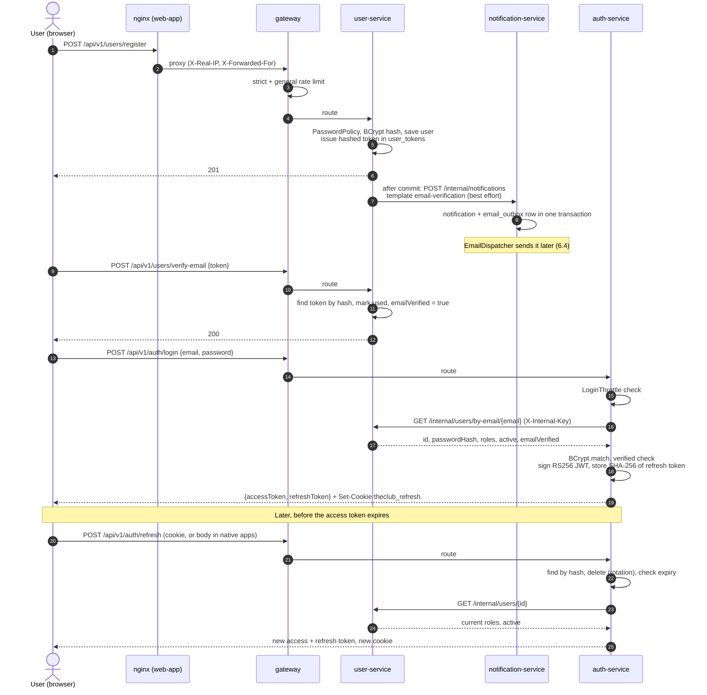

### 6.2 Owner application, approval, club creation and role grant

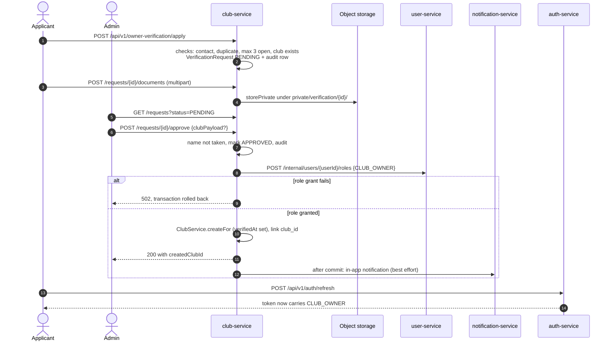

The role grant is a remote call made inside club-service's transaction. If the later club insert fails, the local
transaction rolls back but the role stays granted; that is harmless because every owner action checks ownership of a
specific club.

### 6.3 Event lifecycle, registration, payment, ticket, check-in and points

Events are created as `DRAFT` from the web app (`publish: false`), published to `SCHEDULED` (announced to followers
and subscribers via club-service's `/audience`), and moved to `COMPLETED` or `CANCELLED` by explicit calls; no job
completes events automatically. Full status tables are in
[SERVICE_CONTRACTS.md](SERVICE_CONTRACTS.md#event-lifecycle).

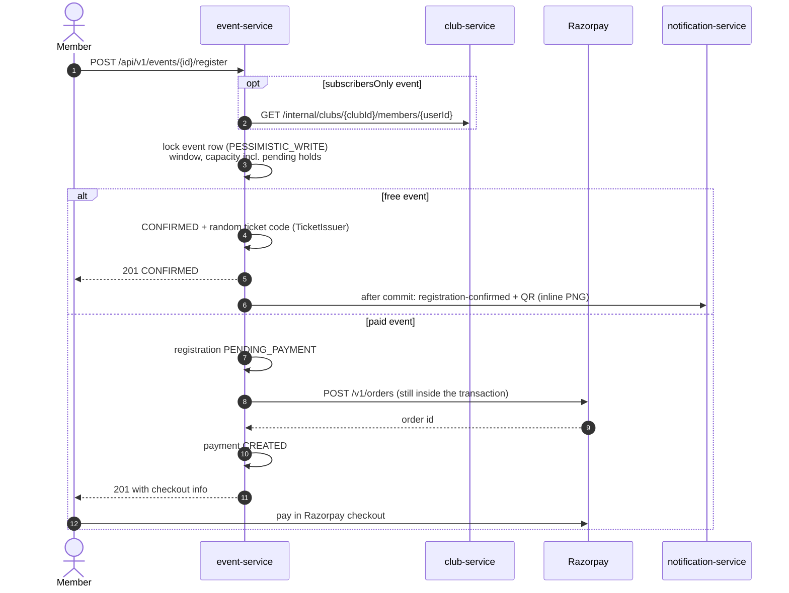

Settling a paid registration: three independent triggers, one code path.

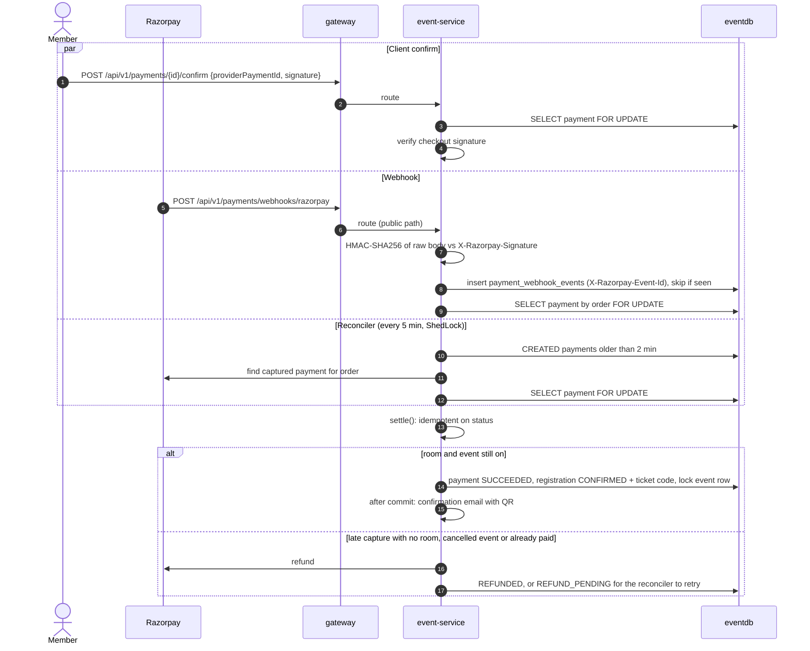

The reconciler also expires `CREATED` payments older than `PAYMENT_PENDING_HOLD` (15 min), cancelling the pending
registration to free the seat, and retries `REFUND_PENDING` refunds. Each payment is processed in its own transaction.

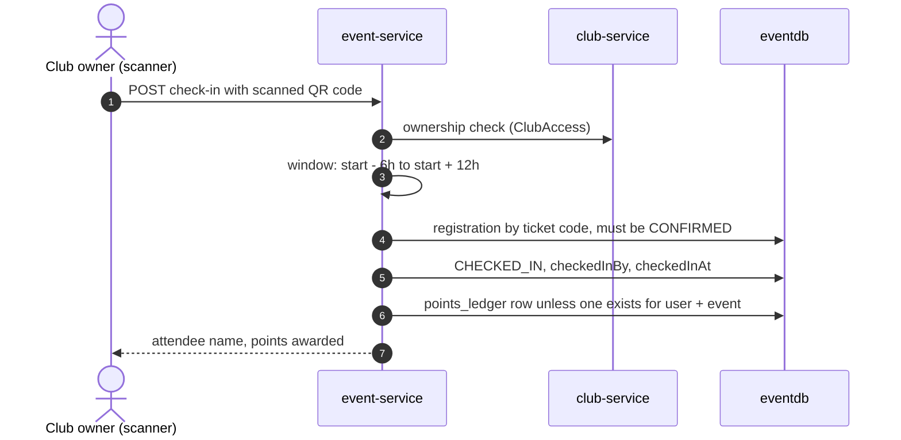

Points feed `/api/v1/participation/**` and the monthly `/api/v1/leaderboards/**`; every `POINTS_EVENTS_PER_STAR`
(default 5) attended events earn a star. Club leaderboards (distance, time, sessions) are built by club-service from
activity-service's `/internal/activities/stats`.

### 6.4 Email via the notification outbox

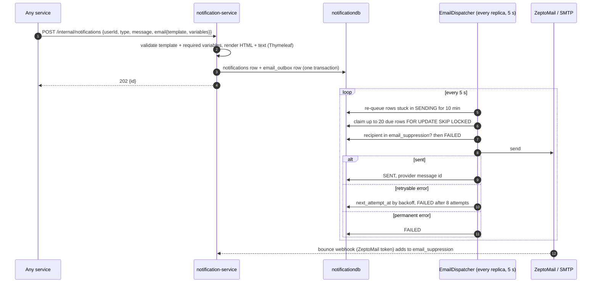

Callers send these requests **after their own transaction commits and best effort**: a failure is logged and dropped
(`AccountMailer`, `ConfirmationNotifier`, `NotificationPublisher`, `StravaNotifier`). Once notification-service has
answered 202, delivery is durable.

### 6.5 Strava OAuth and webhook sync

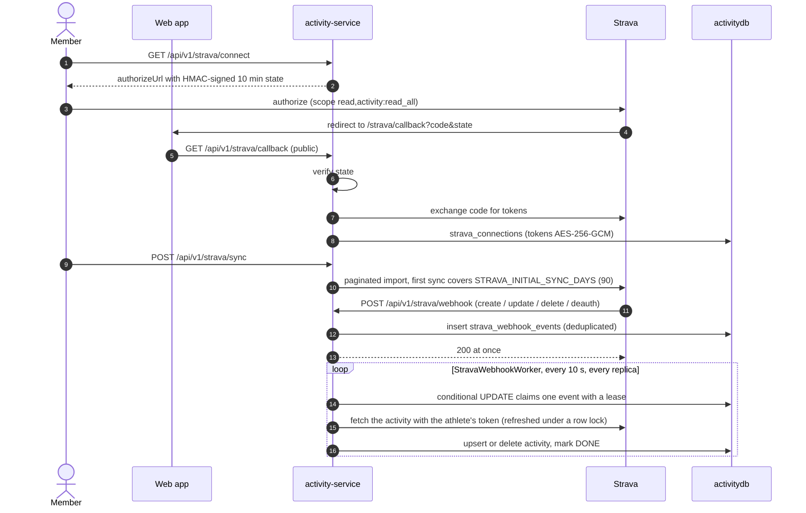

Retries back off 1 m, 5 m, 15 m, then hourly; an event fails after 6 attempts. At 90 % of Strava's 15-minute or daily
budget, or on a 429, outbound calls pause and queued work is requeued (`StravaRateLimiter`). Revoked access marks the
connection `REVOKED` and notifies the member. Details: [SERVICE_CONTRACTS.md](SERVICE_CONTRACTS.md#strava-activity-service).

### 6.6 Upcoming-events feed

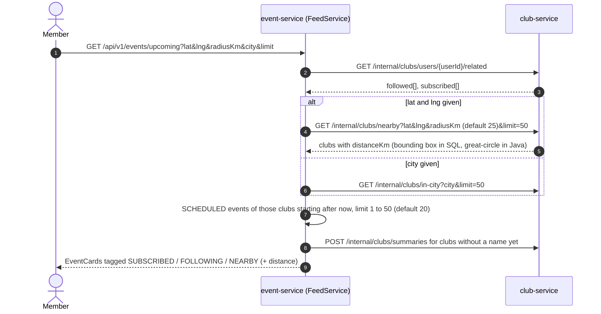

---

## 7. Data architecture

* **Database per service.** Five MySQL databases on one MySQL server and one PostgreSQL database, each with its own
  least-privilege user (`theclub_<service>`), created by `docker/mysql/initdb/01-service-users.sh` and
  `docker/postgres/initdb/01-service-user.sh` (copied into the chart under `files/`; CI diffs the copies).
* **No cross-service foreign keys.** Another service's IDs are plain `CHAR(36)` columns. Cross-service data is fetched
  over Feign, usually in batches (`/summaries` endpoints) so pages do not fan out per row. Consistency across services
  is eventual and best effort: there are no distributed transactions or sagas.
* **Flyway owns the schema.** Migrations live in `<service>/src/main/resources/db/migration` (`V<n>__desc.sql`);
  Hibernate runs `ddl-auto: validate` and `open-in-view: false`. `baseline-on-migrate` adopts databases created by the
  old `ddl-auto=update` at version 1. Migrations are forward-only, so a rollback runs old code against the new schema;
  keep changes additive. Current heads: user V3, auth V1, activity V2, club V5, event V3, notification V2.
* **Types.** UUIDs `CHAR(36)`, timestamps `DATETIME(6)` / `TIMESTAMP(6)`, money `DECIMAL(10,2)`, enums `VARCHAR`.
* **Locking.** Payments and events use `@Lock(PESSIMISTIC_WRITE)` queries (`PaymentRepository`, `EventRepository`);
  the email outbox uses `FOR UPDATE SKIP LOCKED` (plain `FOR UPDATE` on H2); Strava events are claimed by a conditional
  `UPDATE`; optimistic-lock conflicts surface as 409.
* **Tests.** Every Spring test context runs Flyway on an isolated H2 (`jdbc:h2:mem:${random.uuid}`, MySQL or PostgreSQL
  mode) and validates the entities, so SQL must stay portable. `*MigrationIntegrationTest` runs the migrations against
  real MySQL 8.4 / PostgreSQL 15 via Testcontainers when Docker is available.
* **Backups.** `scripts/backup.sh` dumps each database nightly (`BACKUP_SCHEDULE`, default 02:30 in `APP_TIME_ZONE`) with
  `mysqldump --single-transaction` or `pg_dump`, gzipped, kept `BACKUP_RETENTION_DAYS` (14). Compose runs it in
  `db-backup-mysql` / `db-backup-postgres` into the `backups` volume; the chart runs one scheduler Deployment per engine
  (embedded databases only). `backup-offsite` / `backups.offsite` copy new dumps to any rclone target hourly. Uploaded
  images are not in the dumps. Restore: `scripts/restore.sh`.

---

## 8. Asynchronous and scheduled work

There is no message broker. Asynchrony is database-backed and every job is safe with several replicas.

| Job | Service | Schedule | Multi-replica safety | Failure behaviour |
|---|---|---|---|---|
| `EmailDispatcher` | notification | fixed delay `MAIL_DISPATCHER_INTERVAL` (5 s), first after 10 s | `SELECT … FOR UPDATE SKIP LOCKED` batches of 20; rows stuck `SENDING` for 10 min are re-queued | Backoff 1 m, 5 m, 15 m, 1 h, 6 h; `FAILED` after 8 attempts or on a permanent error; admins retry via `/api/v1/notifications/admin/email-outbox/{id}/retry`. Metric `theclub_email_outbox_pending`. |
| `PaymentReconciler` | event | fixed delay `PAYMENT_RECONCILE_INTERVAL` (5 min), first after 1 min | ShedLock `payment-reconciler` in `eventdb.shedlock`, DB time, at most 10 min, at least 30 s | Per-payment try/catch, counted as `outcome=error`; next run retries. Disabled with `PAYMENT_RECONCILE_ENABLED=false`. |
| `StravaWebhookWorker` | activity | fixed delay 10 s, first after 20 s, batch `STRAVA_WORKER_BATCH_SIZE` (25) | Conditional `UPDATE` claim with a lease | Backoff, `FAILED` after 6 attempts, finished rows deleted after 30 days; while Strava's rate limit is paused, work is requeued rather than failed |
| `ChatRelay` | club | fixed delay `CHAT_RELAY_INTERVAL` (2 s) | Each replica reads messages written by others | Safety net when `CHAT_FANOUT=redis`; the only cross-replica path otherwise |
| `ChatHub` heartbeat | club | every 20 s | Per replica (its own SSE connections) | Keep-alive comment so proxies keep idle streams open; clients reconnect after the 15-minute stream timeout |
| `AdminBootstrap` | user | startup | Tolerates two pods racing | — |

After-commit hooks (`TransactionSynchronization.afterCommit`) are used for every outbound notification so a remote call
never holds a database transaction, except where noted in §11.

---

## 9. Deployment topologies

### 9.1 Docker Compose

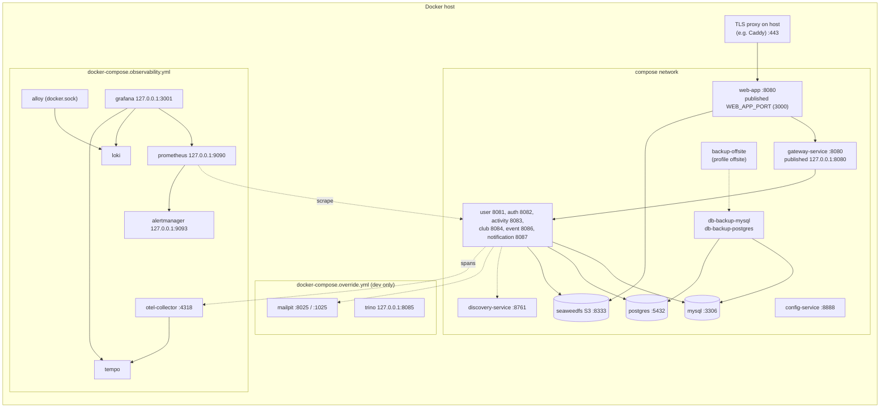

| Mode | Command | Differences |
|---|---|---|
| Development | `docker compose up -d --build` | Loads `docker-compose.override.yml`: database, Eureka, config and service ports on `127.0.0.1`, Mailpit (notification-service uses SMTP to `mailpit:1025` unless `DEV_MAIL_PROVIDER` is set), Trino, strict rate limit raised to 120/min. `.env` defaults: `dev` profile, mock payments, email verification off, insecure cookie. |
| Production | `docker compose -f docker-compose.yml up -d --build` | Base file only. `SPRING_PROFILES_ACTIVE=prod` and the settings in [PRODUCTION.md](PRODUCTION.md). |
| Observability | add `-f docker-compose.observability.yml` | Turns on `TRACING_ENABLED`, ECS JSON logs, and adds the stack above |
| Off-site backups | add `--profile offsite` | Starts `backup-offsite` (rclone) |

Every Spring image runs as uid 10001 with a `HEALTHCHECK` on `/actuator/health` (bash `/dev/tcp`, 90 s start period);
dependants wait for `service_healthy`. Memory limits are 768 MiB per domain service and 512 MiB for the gateway,
Eureka and config-service, with `-XX:MaxRAMPercentage=75 -XX:+ExitOnOutOfMemoryError`. Logs use `json-file`,
5 × 20 MB per container. Services drain for up to 20 s on SIGTERM (`server.shutdown: graceful`).

### 9.2 Kubernetes (Helm)

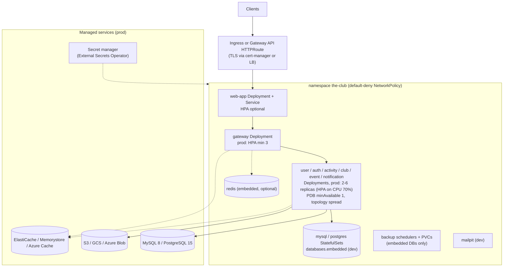

* One Deployment and ClusterIP Service per component (`templates/services.yaml`, `web-app.yaml`); ConfigMap
  `<release>-env` from `config.*`; one Secret mounted per key under `/run/secrets/<VARIABLE>`.
* **Probes:** startup and liveness on `/actuator/health/liveness` (startup allows 5 s × 60 for Flyway), readiness on
  `/actuator/health/readiness`, which includes the database for DB-backed services.
* **Rollouts:** `maxUnavailable: 0`, `preStop` sleep 5 s, `terminationGracePeriodSeconds: 45`; config changes roll pods
  through a checksum annotation.
* **Pod hardening:** non-root, read-only root filesystem with an `/tmp` emptyDir, all capabilities dropped,
  `RuntimeDefault` seccomp, no service-account token.
* **NetworkPolicies** (`templates/networkpolicies.yaml`): default deny plus DNS; the web app only from the ingress
  controller namespace and only to the gateway; each service only to the services in `services.<name>.calls`, its
  database CIDRs, OTLP, and internet egress on 443/587/465 where `internetEgress: true`; Redis only from the gateway and
  club-service; optional metadata-server egress for GKE Workload Identity.
* **HPA** (`autoscaling/v2`, CPU) and **PDB** (`minAvailable: 1`, rendered only for workloads with more than one replica
  or autoscaling).
* **Redis:** `redis.enabled` sets `REDIS_ENABLED=true`, `RATE_LIMIT_STORE=redis` and `CHAT_FANOUT=redis`; embedded
  `redis:7.4-alpine` or a managed endpoint.
* **Values layering:** `values.yaml` (defaults, `dev` profile) → `values-dev.yaml` (kind: embedded databases, Mailpit,
  mock payments) or `values-prod.yaml` (prod profile, managed databases with TLS params, HPA) → optional
  `values-aws.yaml`, `values-gcp.yaml`, `values-azure.yaml` (managed Redis, object storage, workload identity). CI runs
  `helm lint --strict` and kubeconform on each combination.
* **Local cluster:** `deploy/kind/up.sh` builds images, creates the `theclub` kind cluster with Traefik, and installs
  `values-dev.yaml` at http://localhost:8088.

### 9.3 Ports

| Component | Container port | Published (Compose) |
|---|---|---|
| web-app (nginx) | 8080 | `WEB_APP_PORT` (default 3000; `127.0.0.1:3000` behind a host TLS proxy) |
| gateway-service | 8080 | `127.0.0.1:${GATEWAY_SERVICE_PORT}` (8080) |
| user / auth / activity / club / event / notification | 8081 / 8082 / 8083 / 8084 / 8086 / 8087 | dev override only, `127.0.0.1` |
| discovery-service / config-service | 8761 / 8888 | dev override only |
| MySQL / PostgreSQL | 3306 / 5432 | dev override only |
| SeaweedFS S3 | 8333 | never |
| Mailpit UI / SMTP | 8025 / 1025 | `127.0.0.1:8025` (dev) |
| Trino | 8080 | `127.0.0.1:${TRINO_PORT}` (8085, dev) |
| Grafana / Prometheus / Alertmanager | 3000 / 9090 / 9093 | `127.0.0.1:3001` / `:9090` / `:9093` |
| OTel Collector (OTLP HTTP) | 4318 | never |
| Vite dev server | 5173 | `npm run dev` (proxies `/api` and `/media`) |
| kind | — | `http://localhost:8088` (`KIND_HTTP_PORT`) |

Port 8085 is skipped by the services because Trino uses it on the host.

---

## 10. Observability

Summary only; [OBSERVABILITY.md](OBSERVABILITY.md) is the reference.

* **Metrics.** Every service exposes `/actuator/prometheus` (internal only: nginx proxies only `/api` and `/media`, and
  the gateway has no `/actuator` route). Series carry `application=<service>`. HTTP server and client histograms with
  SLO buckets 100 ms, 300 ms, 1 s, 3 s; gateway per-route `spring_cloud_gateway_requests_seconds`; HikariCP and JVM
  metrics; business counters `theclub_*`. Compose Prometheus scrapes static targets every 15 s; the chart offers
  ServiceMonitors or `prometheus.io/*` annotations.
* **Traces.** Micrometer Tracing with the OpenTelemetry bridge, OTLP/HTTP to the collector, then Tempo. Propagation
  through the gateway, Feign (`feign-micrometer`), `@Async` (`ContextPropagatingTaskDecorator`) and `@Scheduled`.
  Actuator, Eureka and Spring Security filter spans are filtered out. Off unless `TRACING_ENABLED=true`; sampling
  `TRACING_SAMPLING_PROBABILITY` (1.0 in Compose, `0.1` default in the chart).
* **Logs.** Plain text by default; ECS JSON with `traceId`, `spanId` and `requestId` when
  `LOGGING_STRUCTURED_FORMAT_CONSOLE=ecs` (observability compose file, chart default `json`). Alloy ships Docker
  container logs to Loki.
* **Dashboards.** Overview, Business and Gateway, generated by `observability/grafana/generate_dashboards.py` and
  provisioned read-only.
* **Alerts.** `observability/prometheus/alerts.yml`: ServiceDown, HighErrorRate, HighLatencyP95, JvmHeapHigh,
  DatabasePoolExhausted, payment, email-outbox, login-lockout, rate-limit, Strava and AlertDeliveryFailing rules.
* **Alert delivery.** `observability/alertmanager/render-config.sh` renders the receivers at container start from the
  app's mail settings: Mailpit under `dev`, ZeptoMail SMTP or the configured SMTP server otherwise, plus Slack if
  `secrets/alertmanager-slack-webhook` is non-empty. Under `prod` it refuses to start when nothing can deliver, unless
  `ALERT_DELIVERY=none`.
* **Retention.** Metrics 15 days (`PROMETHEUS_RETENTION`), traces 72 h, logs 7 days.

---

## 11. Scalability, resilience and known limitations

### What scales horizontally

* All domain services and the gateway are stateless apart from club-service's in-memory SSE connections, which need
  no sticky sessions (cross-replica delivery via Redis or the 2 s database relay).
* Background jobs are replica-safe (§8). Flyway takes a database lock, so several pods starting together is safe.
* JWT verification is local, so auth-service is on the path only for login, refresh and logout.

### Resilience settings

* Feign: 3 s connect, 10 s read (`spring.cloud.openfeign.client.config.default.*`) in user-, auth-, club- and
  event-service. Unreachable dependency → 503, error response → 502 (`FeignExceptionHandler`).
* Hikari pool `DB_POOL_MAX_SIZE` (default 10) per pod, 5 s connection timeout.
* Eureka clients fetch the registry every 5 s and the load-balancer cache TTL is 5 s, so restarts are seen quickly;
  503s right after startup mean a service has not registered yet.
* Graceful shutdown (20 s per phase) plus Kubernetes `preStop` and readiness gating.

### Known limitations and risks

Each item below was checked in the code or configuration named.

| Area | Limitation | Where |
|---|---|---|
| Rate limiting | With the default `RATE_LIMIT_STORE=memory`, each gateway replica counts separately, so the effective limit is the configured value × replicas (prod Helm runs at least 3 gateway pods). `values-prod.yaml` alone does not enable Redis; the cloud overlays do. With Redis the limiter fails open when Redis is unreachable. | `RateLimitFilter`, `RedisClientLimiter`, `values-prod.yaml`, `values-aws/gcp/azure.yaml` |
| Rate limiting | If nginx's trusted-proxy range (`REAL_IP_FROM` / `webApp.realIpFrom`) does not match the real proxy, every client shares one bucket (10 logins/min for the whole site). | `web-app/15-real-ip.sh`, `ClientIpResolver` |
| Database connections | Pools are per pod: with `values-prod.yaml` (2 to 6 replicas each, pool 10) the five MySQL-backed services can open up to 5 × 6 × 10 = 300 connections to one MySQL server. Size the server's `max_connections` (or lower `DB_POOL_MAX_SIZE` via `config.extraEnv`) accordingly. | service `application.yml`, `values-prod.yaml` |
| Payments | `PaymentService.createFor` calls Razorpay's order API inside the registration transaction, while the event row is locked `PESSIMISTIC_WRITE`; refunds likewise run under the payment row lock. The Razorpay `RestClient` is built without explicit connect/read timeouts, so a slow Razorpay holds the lock and a DB connection and blocks other registrations for the same event. | `RegistrationService.register`, `PaymentService`, `RazorpayPaymentGateway` |
| Notifications | Callers post to notification-service after commit and drop the request on failure; there is no caller-side outbox. An email (verification, ticket, refund) is lost if notification-service is unreachable at that moment. Verification can be resent by the user; tickets remain in the app. | `AccountMailer`, `ConfirmationNotifier`, `NotificationPublisher` |
| Feign timeouts | activity-service does not set the Feign timeouts the other services set, so its notification calls use OpenFeign's defaults. | `activity-service/src/main/resources/application.yml` |
| Image tags | The chart's `appVersion` is `"latest"` and `global.imageTag` defaults to empty, so an install without `--set global.imageTag=<sha>` deploys `:latest` (CI pushes both `:<sha>` and `:latest`). Rollbacks are only meaningful with pinned tags. | `Chart.yaml`, `_helpers.tpl` (`theclub.imageTag`) |
| Backups | Dumps are gzip only, not encrypted, both in the `backups` volume and in the off-site rclone copy as configured. Use an encrypted bucket or an rclone `crypt` remote. Uploaded images are not backed up by these jobs. | `scripts/backup.sh`, `docker-compose.yml` `backup-offsite` |
| NetworkPolicy defaults | `databaseCidrs`, `otlpCidrs`, `internetCidrs` and `redis.cidrs` default to `0.0.0.0/0`; narrow them in production. | `values.yaml` |
| Single points | Compose is one host with one Eureka node, one MySQL and one PostgreSQL. In Kubernetes, the embedded databases and Redis are single instances meant for development. | `docker-compose.yml`, `templates/databases.yaml`, `templates/redis.yaml` |
| Internal trust | One shared `INTERNAL_API_KEY` authorises every internal endpoint of every service; rotation needs all services restarted together. | `InternalApiKeyFilter`, [PRODUCTION.md §8](PRODUCTION.md#8-rotating-the-jwt-signing-key) |
| Cross-service writes | No distributed transactions: the owner role grant and club creation (§6.2) are not atomic, and data owned by one service may reference IDs deleted in another. | `VerificationService.approve` |
| Housekeeping | No scheduled cleanup of expired `user_tokens`, `login_attempts` or expired `auth_tokens`; chat messages are kept until deleted. | no `@Scheduled` job in user- or auth-service |
| Time zone | One platform zone (`APP_TIME_ZONE`) for all event times. | `TheClubCommonAutoConfiguration.clock` |
| Chat | Messages are stored in plain text in `clubdb` (not end-to-end encrypted). | [PRODUCTION.md §6b](PRODUCTION.md#6b-club-chat) |

---

## 12. Repository layout

| Path | Contents |
|---|---|
| `pom.xml` | Parent POM: Boot parent, Spring Cloud and SDK BOMs, module list, dependency versions |
| `common-lib/` | Shared auto-configured library (§4) |
| `gateway-service/` | Spring Cloud Gateway (WebFlux): routes in `application.yml`, `filter/`, `ratelimit/`, `config/` |
| `discovery-service/`, `config-service/` | Eureka server; Config Server (`src/main/resources/config-repo`) |
| `user-service/`, `auth-service/`, `activity-service/`, `club-service/`, `event-service/`, `notification-service/` | Domain services, each with `Dockerfile`, `pom.xml`, `src/main/resources/application.yml`, `db/migration`, and tests with `application-test.yml` and test JWT keys |
| `web-app/` | React SPA (`src/api` HTTP client and types, `src/auth`, `src/components`, `src/lib`, `src/pages`), `nginx.conf`, `security-headers.conf`, `15-real-ip.sh`, `Dockerfile`, `e2e/`, Capacitor `android/` and `ios/`, Tauri `src-tauri/` |
| `docker/mysql/initdb`, `docker/postgres/initdb` | First-start scripts: one database and user per service |
| `docker-compose.yml`, `docker-compose.override.yml`, `docker-compose.observability.yml` | Production-like stack, dev additions, observability stack |
| `observability/` | Prometheus config and alerts, Alertmanager config and `render-config.sh`, OTel Collector, Tempo, Loki, Alloy, Grafana provisioning, dashboards and their generator |
| `deploy/helm/the-club/` | Helm chart: `templates/`, `values*.yaml`, `files/` (copies of init and backup scripts) |
| `deploy/kind/` | Local Kubernetes cluster scripts |
| `scripts/` | `generate-secrets.sh`, `smoke-test.sh`, `seed-demo.sh`, `backup.sh`, `restore.sh` |
| `secrets/` | Generated secret files (git-ignored) |
| `.github/workflows/` | `ci.yml` (backend, web, Helm, images, dependency scan), `codeql.yml`, `apps.yml` (native apps) |
| `enviroinment_variables.env` | Template for `.env` |
| `docs/` | This and the other reference documents |

---

## 13. How to extend

### Add an endpoint to an existing service

1. Add the DTOs in `dto/`, the logic in `service/`, and the mapping in a controller (`controller/`). Internal endpoints
   go in the service's `Internal*Controller` under `/internal/...`; public ones under `/api/v1/...`.
2. Take the caller from `@AuthenticationPrincipal AuthenticatedUser`. For club-scoped actions check ownership
   (`ClubService.requireOwnerOrAdmin` or event-service `ClubAccess`), never the role alone.
3. If the endpoint must work without a token, add it to `theclub.security.public-paths` in that service's
   `application.yml` and authenticate it another way.
4. Throw `ApiException` (with a `code` if clients must branch); use the injected `Clock` and `UuidGenerator`.
5. If the path prefix is new, add it to the route's `Path=` predicate in `gateway-service/src/main/resources/application.yml`.
   If it is a credential or account-recovery POST, consider the strict rate-limit paths in `GatewayHardeningProperties`.
6. Calling another service: add a method to `<service>/client/*Client.java` (Feign); the internal key and request ID
   are added automatically. Do remote calls outside database transactions or after commit, and mock the client in
   `*IntegrationTest`.
7. Add the endpoint to [SERVICE_CONTRACTS.md](SERVICE_CONTRACTS.md), and update `web-app/src/api/endpoints.ts` and
   `types.ts` if the web app uses it.

### Add a migration

Add `V<next>__<description>.sql` to the service's `src/main/resources/db/migration`, update the entity, and run
`mvn -pl <service> -am test`. Never edit an applied migration; keep the SQL H2-compatible; keep changes additive for
safe rollbacks. See [DATABASE_MIGRATIONS.md](DATABASE_MIGRATIONS.md).

### Add a scheduled job

Use `@Scheduled` with a configurable interval. If only one replica may run it, use ShedLock as `PaymentReconciler`
does (event-service has `SchedulerLockConfig` and the `shedlock` table; another service needs the dependency, a lock
provider and a migration for the table). If every replica may run it, claim work with row locks
(`SKIP LOCKED`) or a conditional `UPDATE`. Add a `theclub_*` metric for its outcomes.

### Add a service

1. Create the module (copy an existing service's `pom.xml`, `Dockerfile`, `application.yml`), add it to `<modules>`
   in the parent `pom.xml`, and depend on `common-lib`, `spring-boot-starter-flyway`, the database driver and
   `feign-micrometer` if it calls others.
2. Give it its own database and user in `docker/mysql/initdb/01-service-users.sh` or the PostgreSQL script, and copy the
   script to `deploy/helm/the-club/files/` (CI diffs them).
3. Compose: add the service with `x-spring-service`, `x-spring-env`, its secrets as `/run/secrets/<PLACEHOLDER>` and
   `depends_on`; add a host port in the override file; add the scrape target in `observability/prometheus/prometheus.yml`.
4. Gateway: add a route with `uri: ${<NAME>_SERVICE_URI:lb://<name>-service}`.
5. Helm: add an entry under `services:` in `values.yaml` (image, port, database, `calls`, `internetEgress`,
   secret files), and add it to the `calls` of the services that call it so the NetworkPolicies allow the traffic.
6. CI: add the image to the matrix in `.github/workflows/ci.yml`.
7. Document its routes and internal endpoints in [SERVICE_CONTRACTS.md](SERVICE_CONTRACTS.md) and add it to the
   catalogue in §3 of this document.
